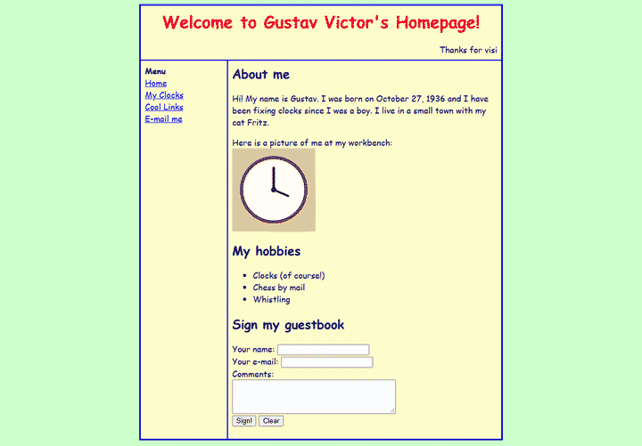
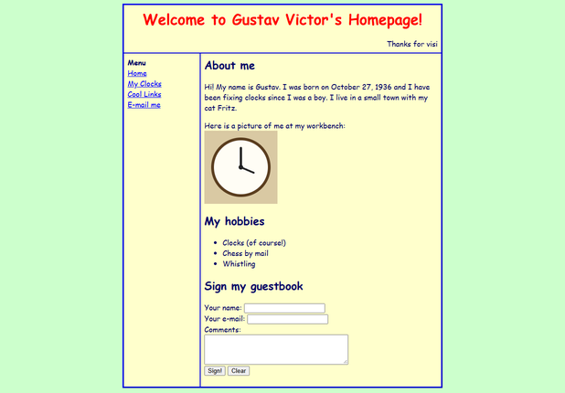
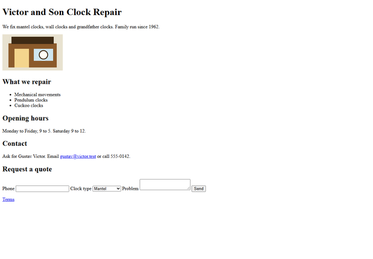
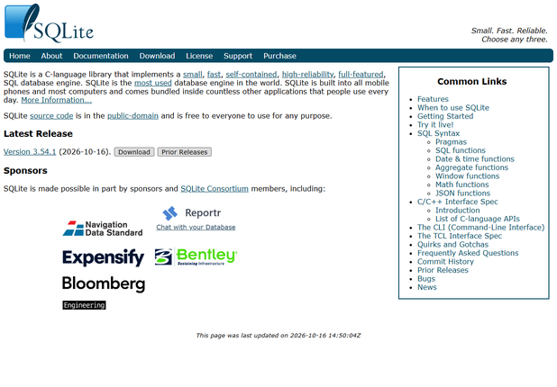
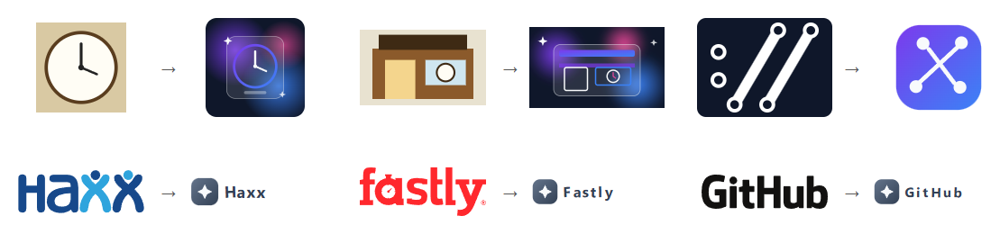

# de-slopper

Hate human slop? Turn it into AI slop today!

de-slopper takes code and web pages written by humans and makes them look
like an AI wrote them. It works on Python files and HTML pages.



## Screenshots

| | Before | After |
| --- | --- | --- |
| Gustav's homepage |  |  |
| Gustav's shop |  |  |
| curl.se |  |  |
| sqlite.org |  |  |

With `--ultra`, every image and logo is redrawn by the model as an SVG.



## Python

Point it at a Python file. Comments explain what every line already says.
Every function gets a docstring, a `try`/`except`, logging and a guard for
`None`. Names get longer, constants get extracted, and a wrapper class
appears for no reason. The behavior stays the same.

Before:

```python
def label(name, price):
    # pad it so the columns line up
    return name.ljust(12) + "$" + format(price, ".2f")
```

After:

```python
def label(name, price):
    """Format a display label for an item — name padded, price formatted.

    Args:
        name: The item's display name.
        price: The numeric price to render.

    Returns:
        The composed, alignment-friendly label string.
    """
    try:
        logger.info("Building the display label — hang tight ✨")
        if name is None:
            logger.warning("name is None, which is not ideal ⚠️")
        # pad it so the columns line up
        return name.ljust(LABEL_COLUMN_PADDING_WIDTH_LENGTH) + CURRENCY_SYMBOL_PREFIX_SEPARATOR + format(price, PRICE_FORMAT_DECIMAL_PRECISION_PATTERN)
    except Exception as e:
        logger.error("Failed to build the label, oh dear: %s", e)
        raise
```

It also writes tests. The 42-line `inventory.py` in `tests/fixtures` came
out as 183 lines, plus 410 lines of tests: 51 of them, 5 marked
`@pytest.mark.skip(reason="Temporarily disabled, will fix later")`.

## Web pages

Point it at an HTML page and you get a landing page: a purple gradient hero,
"Revolutionize the Way You...", stats, feature cards with emoji, testimonials,
an FAQ and a dark mode toggle. Your original content is still there, word for
word, restyled to match. With `--ultra`, the images and logos are redrawn too.

## Install

```
pip install git+https://github.com/aravpanwar/de-slopper
```

Python 3.11 or newer. For `--screenshot`, install the extra and a browser:

```
pip install "de-slopper[screenshot] @ git+https://github.com/aravpanwar/de-slopper"
playwright install chromium
```

## Use

It needs an OpenAI-compatible API. DeepSeek is the default, and a sweep costs
a fraction of a cent.

```
export DESLOPPER_API_KEY=...
de-slopper inventory.py -o out/
de-slopper site/ -o out/ --ultra --screenshot
```

| option | what it does |
|---|---|
| `-o PATH` | where to write the output (required for a directory) |
| `--no-tests` | don't write test files |
| `--react` | also write a `LandingPage.tsx` for each page |
| `--ultra` | also redraw every image as an SVG |
| `--screenshot` | also save before and after PNGs of each page |
| `--receipt PATH` | where to write the receipt |

`DESLOPPER_BASE_URL` and `DESLOPPER_MODEL` point it at another provider or
model. Markdown files work too: they are turned into a page first.

Your input files are never overwritten. If the output path is the input, the
original is saved next to it as `name.orig.py` first.

## How it works

The model never rewrites your file. It plans a list of edits from a fixed set
(add a docstring, wrap in `try`, rename a variable, restyle an element...),
and de-slopper applies them itself with
[libcst](https://github.com/Instagram/LibCST) and
[Beautiful Soup](https://www.crummy.com/software/BeautifulSoup/). An edit that
would change behavior or lose content is refused. After a sweep, de-slopper
checks that the Python still imports and keeps its function signatures, and
that the page still has every word, link and script it started with.

Every edit is written to a receipt, and each AI habit is paired with the human
one it came from:

```
tone: load bearing x4
    AI habit:      calling things load-bearing
    human version: the consultant deck: "this assumption is load-bearing"
tone: buzzwords x16
    AI habit:      robust, seamless, leverage, comprehensive, delve
    human version: the press release and the synergy slide
swept 1 file: 54 applied, 1 skipped, 0 rejected, 0 dropped
Your code is now 98% professional.
```

**Note:** checking the result means running your code. de-slopper imports
each swept Python file and runs the tests it writes, so only sweep code you
would run anyway.

## License

MIT
